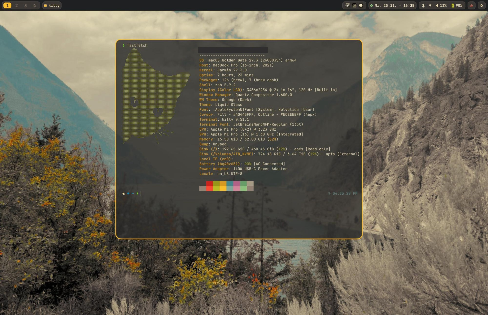

# dotfiles – macOS with a Linux feel



| Folder | Contents |
|---|---|
| `rift/` | Rift tiling WM, niri style (scrolling layout, 50 % columns, app rules, key bindings) |
| `sketchybar/` | Bubble bar (Gruvbox): workspaces, media, tray, Bluetooth, Wi‑Fi, volume, battery, calendar, power menu, Control Center, REC indicator; `helpers/*.swift` are compiled on install |
| `kitty/` | Terminal with Linux-style Ctrl bindings, Gruvbox theme |
| `vscode/` | VS Code key bindings for the swapped modifiers (Ctrl+H replace, multi-cursor on ⌘+Shift+↑/↓) |
| `zsh/` | Gruvbox colors for Powerlevel10k (lean) and fzf, sourced from `~/.zshrc` |
| `borders/` | Window borders (yellow = focused) |
| `launcher/` | rofi-like app launcher (choose) on physical ⌥+Space, plus window helpers |
| `macos/` | Modifier swap (Ctrl→⌘, ⌘→⌥, ⌥→Ctrl) and faster animations |
| `btt/` | BetterTouchTool preset and notes |
| `tools/` | `gruvboxify` – recolor any image (e.g. a wallpaper) to the Gruvbox palette |
| `assets/` | Screenshot and the Gruvbox wallpaper (`wallpaper-gruvbox.jpg`, made with `gruvboxify`) |
| `Brewfile` | All Homebrew packages |

## Usage
```bash
./sync.sh                     # system → repo (then commit)
./install.sh                  # repo → system
./install.sh --brew --macos   # fresh Mac: also install packages and apply macOS settings
```

Personal home paths are stored as `__HOME__` in the repo; `install.sh` replaces them with your `$HOME`.

After a fresh install, grant **sketchybar** these permissions in Privacy & Security:
Accessibility, Screen & System Audio Recording, Bluetooth.
